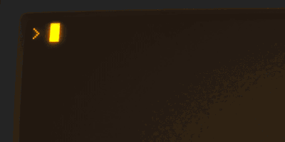
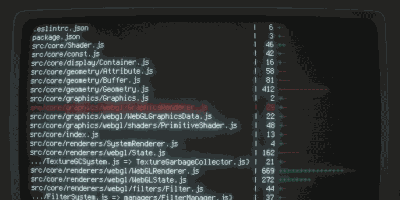
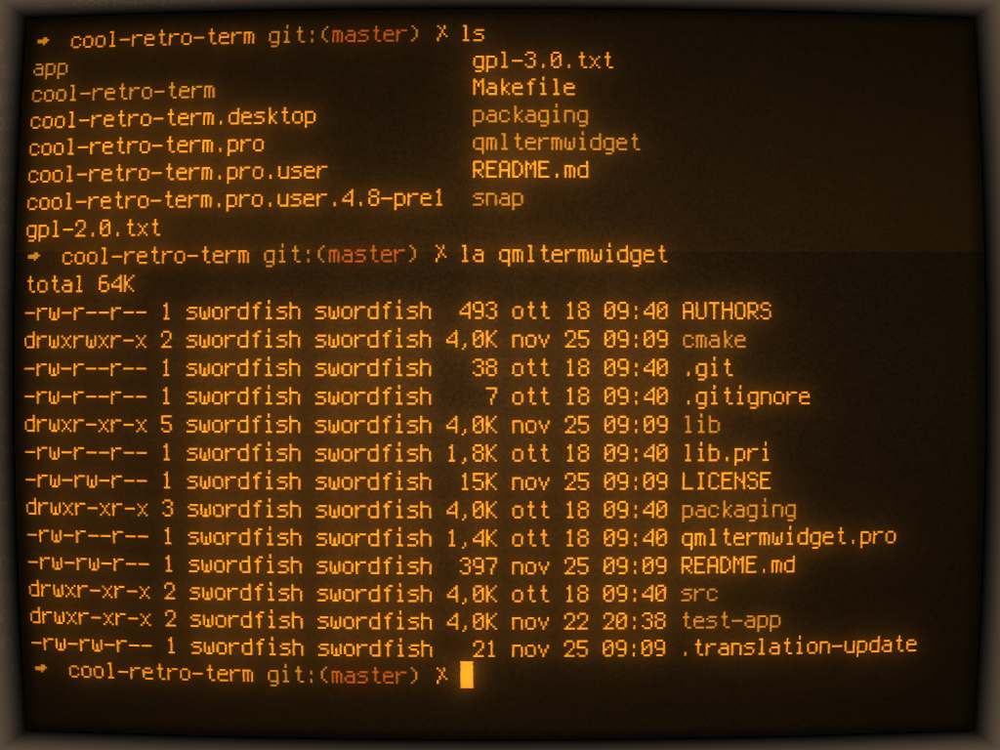
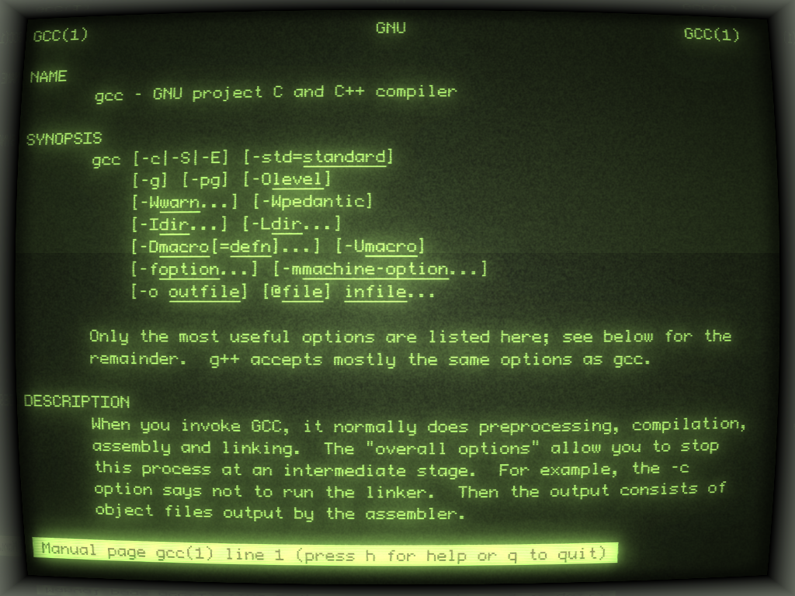
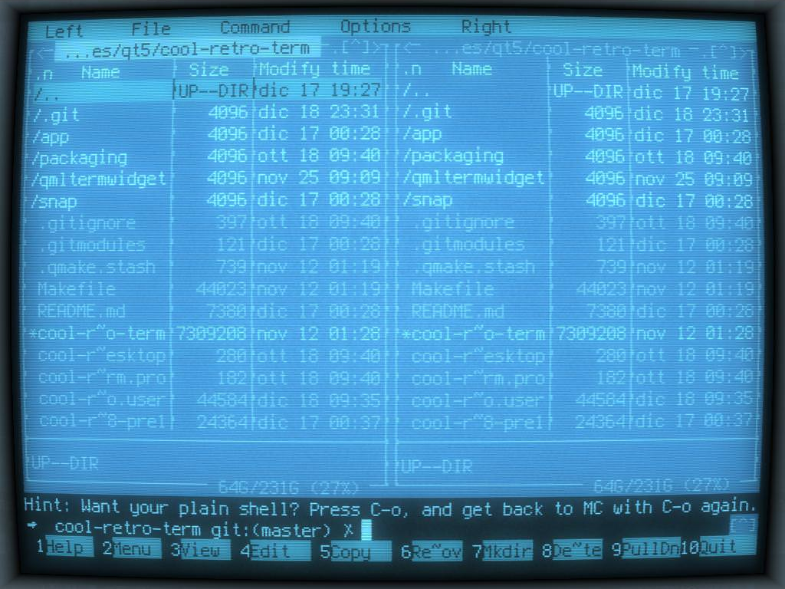

# cool-retro-term for Windows - Enhanced Edition

| Default Amber | IBM DOS | Default Green |
| :---: | :---: | :---: |
|  |  |  |

## Description

cool-retro-term is a customizable terminal emulator that recreates the glow, curvature and texture of old CRT displays. This fork brings the classic **cool-retro-term 1.1.1** looks to Windows.

## Screenshots

The animations and screenshots come from the [original cool-retro-term project](https://github.com/Swordfish90/cool-retro-term). The three stills below have their title bars removed. And yet, unlike other ports, these screenshots are 99.9% identical to the ones provided by this port. 

## Profiles

Nine presets follow the original 1.1.1 looks: Default Amber, Monochrome Green, Green Scanlines, Pixelated, Apple ][ Dark, Vintage, IBM DOS, IBM 3278 and Futuristic. The other presets build on existing designs, with tweaks for a more realistic look or to suit the fork author's taste. Pick any of the 21 presets from **Profiles**, then adjust colors, fonts and effects in Settings.

## What this fork adds

- **Shell selection in the enhanced release.** Choose PowerShell (automatic), Command Prompt or your default WSL distribution under **Settings → Advanced → Startup shell**. You can also run a custom command at startup or choose a shell for a single tab under **File → New Tab With Shell**. Changes to the startup shell apply to new sessions. WSL requires an installed distribution.
- **Classic CRT rendering:** scanline and pixel masks are applied before bloom, with curvature, bezel and glow based on the 1.1.1 renderer. Futuristic retains its translucent window.
- **Restored and refreshed profiles:** nine 1.1.1-inspired looks alongside adjusted existing presets, including bundled classic fonts and a C64 Pro Mono option. Older Classic profile names are recognized for compatibility.
- **Windows window controls:** options for a borderless window and menu bar visibility, accessible through the application settings and menus. Resize and move borderless windows (Alt and left click).
- **Windows build:** a CMake/Ninja build and deployment script that compiles the shaders and prepares a runnable `build/app` directory.

The classic presets were compared with the original 1.1.1 application in WSL at 1024×768 and 1× scaling. Measured row pitch matched for all nine; IBM 3278 and Futuristic rendered slightly heavier glyphs on Windows.

## Run on Windows

1. Open [this fork’s Releases page](https://github.com/andresdelcampo/cool-retro-term-windows/releases) and select the Enhanced release.
2. Download the Windows ZIP under **Assets** and extract it to a folder.
3. Run `cool-retro-term.exe` from that folder. Keep the extracted files together.

The ZIP is portable and requires Windows 10 version 1809 or later, or Windows 11. See [Build from source](HOW_TO_INSTALL.md#option-2-build-from-source) for the compiler and Qt requirements.

## Earlier work and credits

This fork builds on [pushingpandas' Windows port](https://github.com/pushingpandas/cool-retro-term-windows), which adapts the QML port of qtermwidget for Windows using a ConPTY backend, threaded pipe I/O and OpenGL rendering. It detects PowerShell Core, Windows PowerShell or Command Prompt and provides Windows menus and deployment support.

The original [cool-retro-term](https://github.com/Swordfish90/cool-retro-term) was created by Filippo Scognamiglio. Its repository also contains the Linux and macOS versions. The original project and the Windows port supplied the profiles and foundations revisited here.

## License and contact

GPL v3; see [LICENSE](LICENSE). Original copyright © 2013–2021 Filippo Scognamiglio. Windows port copyright © 2024 pushingpandas.

Earlier Windows port: A. Prior — [a.prior@pushingpandas.io](mailto:a.prior@pushingpandas.io) | [pushingpandas.io](https://pushingpandas.io)
